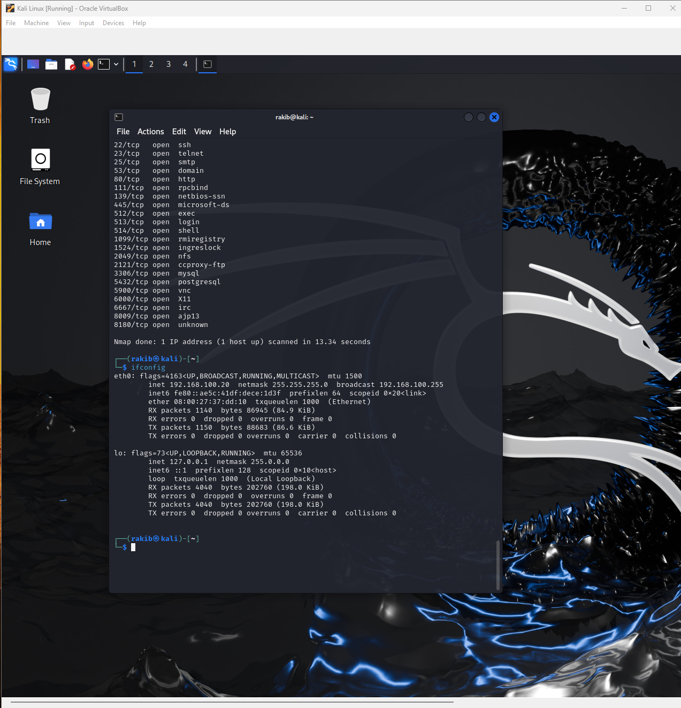
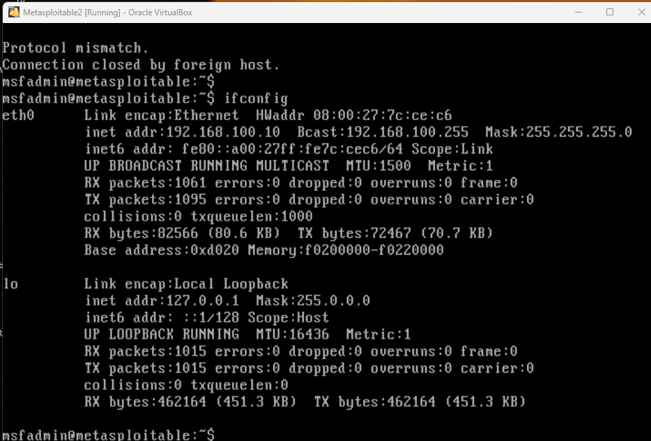
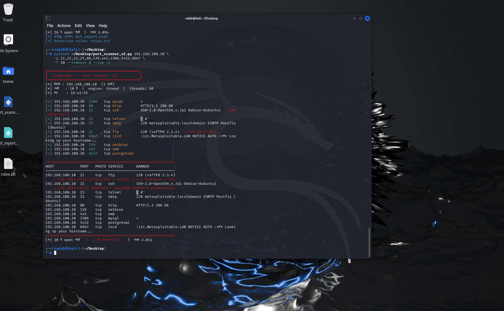
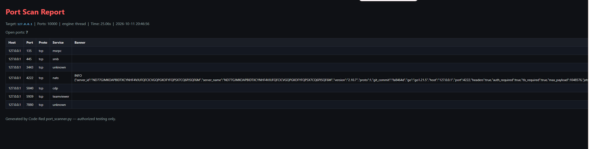
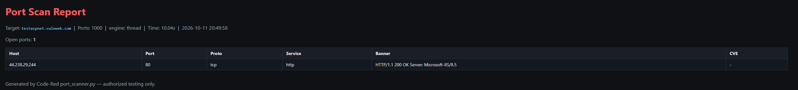
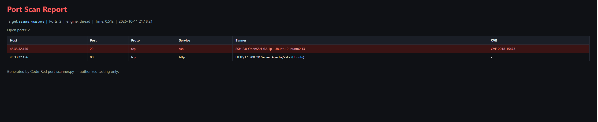
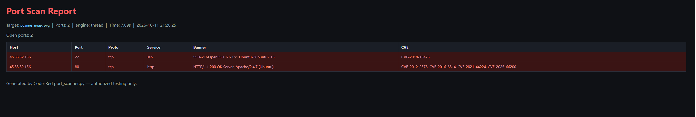
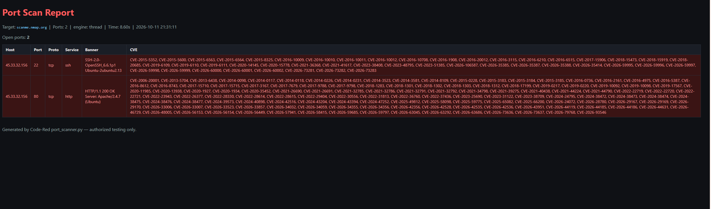
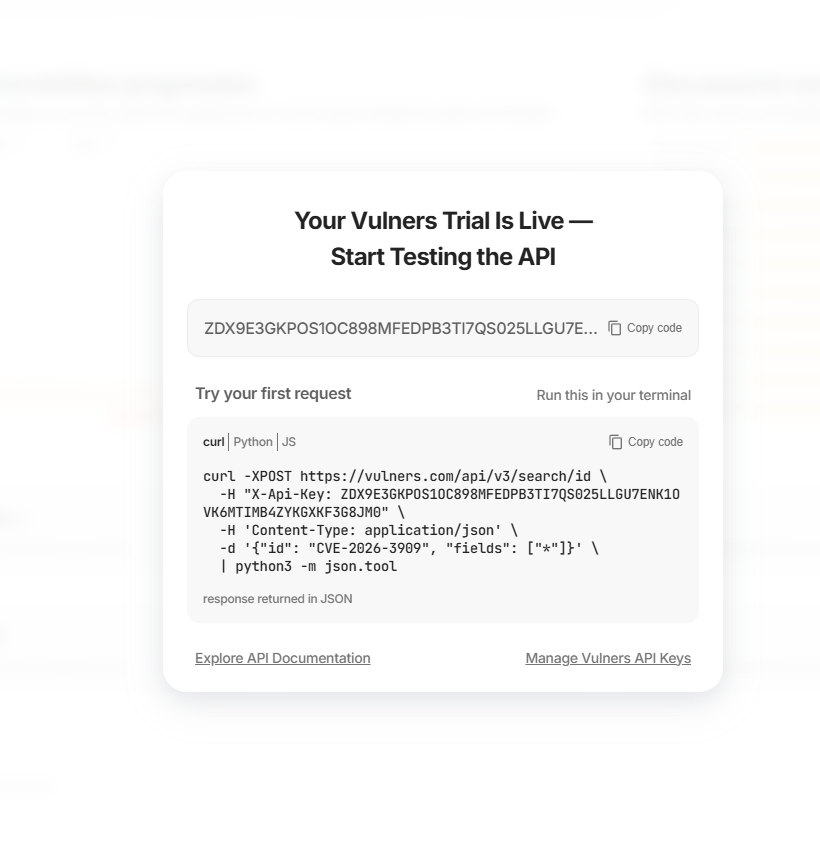

# Project 03 — Port Scanner (from raw sockets)

> **Status:** ✅ Done
> Part of [00 - Foundations](../README.md) — Code-Red, Red Team Operations.

A multithreaded TCP/UDP port scanner built from **raw sockets** using only the
Python standard library — no `nmap`, no external packages for the core engine.
It fingerprints the software behind each open port, looks up known CVEs from
several sources (offline **or** live), generates a clean organized report, and
even writes detection rules for the very scan it performs.

The goal was **not** to replace `nmap`, but to understand what a scanner really
does under the hood — and to build a tool whose software detection is on par
with `nmap`, with a CVE pipeline written from scratch.

---

## Table of contents

1. [Objective](#objective)
2. [Background — the concepts](#background--the-concepts)
3. [Development journey (v1 → v6)](#development-journey-v1--v6)
4. [Lab setup](#lab-setup)
5. [ATT&CK mapping](#attck-mapping)
6. [How the tool works](#how-the-tool-works)
7. [Execution & results](#execution--results)
8. [Offline → online: growing the CVE coverage](#offline--online-growing-the-cve-coverage)
9. [Comparison with nmap](#comparison-with-nmap)
10. [Detection companion (blue team)](#detection-companion-blue-team)
11. [API keys — kept out of the repo](#api-keys--kept-out-of-the-repo)
12. [Usage](#usage)
13. [Lessons learned](#lessons-learned)
14. [Legal / ethics](#legal--ethics)

---

## Objective

- Understand the **TCP connect scan**, **banner grabbing** and
  **service/version identification** by building them from scratch.
- Turn a raw banner (`220 (vsFTPd 2.3.4)`) into a precise `(product, version)` —
  my own **fingerprint engine**.
- Match that version against CVEs: **offline** for isolated labs and **online**
  (NVD + vulners) when internet is available.
- Add a **blue-team** companion: generate detection rules for the scan itself.

---

## Background — the concepts

A quick tour of the ideas the tool is built on.

**Ports.** Think of a server as a building with one address (its **IP**) and
many numbered doors (its **ports**). Each door has a service behind it — port
`22` = SSH, `80`/`443` = web, `21` = FTP, `3306` = MySQL, and so on.

**Port scan.** A scanner knocks on each door and notes whether it is:

| State | What happened |
|---|---|
| **open** | something is listening (the TCP handshake completed) |
| **closed** | the target sent an immediate reset (nothing listening) |
| **filtered** | no reply at all (a firewall is silently dropping packets) |

This tool uses a **TCP connect scan** — the same technique as `nmap -sT`. It
completes the normal TCP 3-way handshake, so it needs no special privileges
(unlike a raw SYN scan). The trade-off: it is noisier (the target logs a full
connection), which is exactly why it is a good *learning* starting point.

**Banner grabbing.** An open door only tells you *something* is listening. The
**banner** tells you *what* — many services announce themselves on connect
(`SSH-2.0-OpenSSH_6.6.1p1`), and for quiet ones (HTTP) you send a small request
first and read the `Server:` header. That software **name + version** is the key
to everything that follows.

**CVE.** A CVE is a publicly catalogued vulnerability (e.g.
`CVE-2011-2523 = the vsftpd 2.3.4 backdoor`). Once you know the software and
version, you can look up which CVEs affect it.

---

## Development journey (v1 → v6)

This tool grew one question at a time — each version came from a real limitation.

| Version | The question that drove it | What was added |
|:--:|---|---|
| **v1** | "`nmap` exists — but what happens *inside* a scanner?" | TCP connect scan, threading, banner grabbing, service name (thread-safe `getservbyport`), CSV/JSON export, CLI flags |
| **v2** | "One port, one host isn't enough — make it a real tool." | CIDR / multi-target, top-ports, color, progress, host discovery, UDP, async & SYN engines, first CVE lookup, Suricata + Wazuh detection rules |
| **v3** | "Prepare it for GitHub; the CVE list is tiny." | Full English rewrite, offline CVE DB 7 → 13, live NVD fallback, fix so the HTTP `Server:` header (and version) is captured |
| **v4** | "The real challenge is identifying the software from the banner." | My own **fingerprint engine** (`banner → product + version`) and **version-range** matching (`<=7.6`, `2.2.*`, `4.80-4.91`) |
| **v5** | "One source isn't enough, and the internet check was wrong." | **Multi-source** CVE lookup (NVD by CPE `virtualMatchString` + vulners.com), fixed internet detection, API keys from file / env |
| **v6** | "Hundreds of CVEs on one line is unreadable." | **Organized HTML report** — grouped by severity, counted, color-coded, each CVE a clickable NVD link; tidy terminal summary |

---

## Lab setup

| Component | Detail |
|---|---|
| Attacker | Kali Linux (VirtualBox) — isolated internal network `192.168.100.0/24` |
| Target | Metasploitable 2 — deliberately vulnerable services |
| Public test target | `scanme.nmap.org` (Nmap's authorized scan host) |

**Kali** (`192.168.100.20`), with an `nmap` baseline against Metasploitable to
compare against later:

[](./screenshots/01-lab-kali.png)

**Metasploitable 2** (`192.168.100.10`), the target:

[](./screenshots/02-lab-metasploitable.png)

> The lab is an **isolated internal network** — no route to the internet. So in
> the lab the tool uses the **offline** CVE DB; the online sources are used from
> an internet-connected machine.

### Why two targets?

The tool has **two CVE paths** — offline and online — so it was tested against
two targets, on purpose:

| Target | Network | What it demonstrates |
|---|---|---|
| **Metasploitable 2** | isolated lab, **no internet** | fingerprinting + the **offline** CVE DB (the realistic case for an air-gapped lab) |
| **`scanme.nmap.org`** | public, **internet-reachable**, authorized | the **online** multi-source CVE lookup (NVD + vulners) and the `nmap` comparison |

The online sources (NVD, vulners) simply cannot run inside the isolated lab —
there is no route to them. So to show that half of the tool actually working,
the scan had to move to an authorized, internet-reachable host. Metasploitable
proves the offline path; `scanme.nmap.org` proves the online path. Together they
cover the whole pipeline.

---

## ATT&CK mapping

| Tactic | Technique |
|---|---|
| Reconnaissance / Discovery | **T1046** — Network Service Discovery |
| Reconnaissance | **T1595** — Active Scanning |

---

## How the tool works

```
open port  →  grab banner  →  FINGERPRINTS: banner → (product, version)
                                   │
          offline ──────────────┐  │  ┌────────────── online
   CVE_DB + version-range match │  │  │  NVD (CPE virtualMatchString) + vulners
                                └──┴──┘
                         combine + de-duplicate → organized report
```

- **Fingerprint engine.** A table of `(regex, product)` where the regex captures
  the version — e.g. `OpenSSH[_/ ]?([\d.]+) → openssh`. This is what makes
  version detection comparable to `nmap`. It grows as new services are met.
- **Version matching (offline).** A small `_ver_match()` handles exact, `<=`,
  ranges (`4.80-4.91`) and wildcards (`2.2.*`) with no external library.
- **Online (comprehensive).** NVD's `virtualMatchString` does **server-side
  version-range matching** — it returns *every* CVE that affects the detected
  `product:version`, the same approach `nmap`'s vulners script uses.

**The `getservbyport` concurrency bug (v1).** Running the service lookup from
many threads at once occasionally returned garbage (a comment line from
`/etc/services`). The function wraps a non-reentrant C call, so two threads could
read each other's half-written result — a classic **race condition**. Fixed with
a lock, with common ports cached to skip the lock on the fast path. *The GIL
protects Python bytecode, not C-library calls.*

---

## Execution & results

### 1. Scanning Metasploitable (offline fingerprint + CVE)

The fingerprint engine reads the banner, extracts the software and version, and
the offline DB flags the known-vulnerable ones — `vsFTPd 2.3.4 → CVE-2011-2523`
(the backdoor, Critical) and `OpenSSH 4.7 → CVE-2018-15473`:

[](./screenshots/03-metasploitable-scan.png)

### 2. The organized HTML report

Open ports, services, banners and a per-port vulnerability summary — grouped by
severity, with each CVE linking to its NVD detail page:

[](./screenshots/04-html-report.png)

### 3. A patched target returns *nothing* — and that's correct

Pointed at an IIS **8.5** host, the fingerprint engine correctly identifies the
server, but no CVE is shown — because IIS 8.5 is a modern, patched version and
the vulnerable entry is for IIS 6.0. **No false positive = correct behaviour:**

[](./screenshots/05-patched-target-iis.png)

> This is an important check: a scanner that flags *everything* is useless. The
> tool only reports a CVE when the detected version is actually affected.

---

## Offline → online: growing the CVE coverage

The same target (`scanme.nmap.org`, OpenSSH 6.6.1 + Apache 2.4.7) scanned three
ways shows how the CVE pipeline evolved across versions:

**Stage 1 — offline DB (isolated lab).** Only the curated signatures match — a
single CVE for OpenSSH, nothing for Apache 2.4.7 (not in the small list):

[](./screenshots/06-offline-one-cve.png)

**Stage 2 — online, NVD keyword search.** A few more, but keyword search only
finds CVEs whose text literally contains the version, so it misses most:

[](./screenshots/07-nvd-keyword-few.png)

**Stage 3 — online, NVD CPE `virtualMatchString` + vulners.** NVD now does
server-side version-range matching, so it returns **every** CVE affecting that
version — comprehensive, `nmap`-level coverage:

[](./screenshots/08-online-comprehensive.png)

> The lesson: a big CVE database is useless without correct **version matching**.
> Switching NVD from keyword to CPE `virtualMatchString` was the single change
> that turned a handful of CVEs into full coverage.

The comprehensive source (vulners) needs a free API key — set once, never in the
code:

[](./screenshots/09-vulners-key.png)

---

## Comparison with nmap

Validated against `scanme.nmap.org` (my tool vs `nmap -sV -p 1-1000 --script vuln`):

| | This tool | nmap |
|---|---|---|
| Version detection | OpenSSH 6.6.1, Apache 2.4.7 | OpenSSH 6.6.1, Apache 2.4.7 |
| CVE coverage (online) | comprehensive — NVD CPE + vulners | comprehensive — vulners |
| CVE coverage (offline) | curated signature DB | n/a |

**Takeaway:** the fingerprint engine matches `nmap`'s version detection exactly.
The only difference is the CVE **database** — `nmap`'s vulners pulls from a huge
online source (lots of coverage, lots of noise), while this tool offers a precise
curated **offline** DB *and* the same comprehensive **online** sources.

---

## Detection companion (blue team)

`--detection rules.txt` generates rules that detect this scan's footprint — many
TCP handshakes from one source in a short window — mapped to MITRE **T1046**:

- a **Suricata** threshold rule
- a **Wazuh** correlation rule

This is the purple-team angle — attack, then detect your own attack — and links
back to the defensive work in [Code-Blue](https://github.com/rakibulhcrafat07/Code-Blue).

---

## API keys — kept out of the repo

The scanner never stores keys in code. It reads them in this order:

1. the flag (`--vulners-key` / `--nvd-key`)
2. an environment variable (`VULNERS_API_KEY` / `NVD_API_KEY`)
3. a local file next to the script (`vulners_key.txt` / `nvd_key.txt`)

To run on any machine without typing the key, copy a `vulners_key.txt` next to
the script (see `vulners_key.txt.example`). **`.gitignore` excludes these files**,
so the key never reaches the public repo.

```bash
cp vulners_key.txt.example vulners_key.txt   # then paste your real key inside
```

---

## Usage

```bash
# Basic scan
python port_scanner.py 192.168.100.10 -p 1-1024 -v

# Full scan + report + detection rules (offline CVE — good for the isolated lab)
python port_scanner.py 192.168.100.10 -p 1-10000 -T 50 --timeout 3 \
    --cve --cve-offline -v --html report.html -o results.json --detection rules.txt

# Online CVE (internet machine) — NVD is automatic, vulners via key file / flag
python port_scanner.py scanme.nmap.org -p 22,80 --cve -v --html report.html

# Whole subnet, discover live hosts first
python port_scanner.py 192.168.100.0/24 --discover --top 100 -o results.csv
```

| Flag | Purpose |
|---|---|
| `-p, --ports` | `22,80,443` or `1-1000` (default `1-1024`) |
| `--top N` | scan only the top N common ports |
| `-T, --threads` | concurrency (default 200) |
| `--engine` | `thread` (default), `async`, or `syn` |
| `--cve` / `--cve-offline` | CVE lookup (auto online/offline) / force offline |
| `--udp` / `--discover` | UDP scan / host discovery |
| `-o`, `--html`, `--detection` | CSV/JSON, HTML report, detection rules |

> Optional: `pip install colorama` (color on Windows), `pip install scapy` (SYN scan, needs admin).

---

## Lessons learned

- **Not every stdlib function is thread-safe** just because Python has a GIL —
  `getservbyport` taught that the hard way.
- **Port scanning is I/O-bound, not CPU-bound** — speed comes from concurrency
  (waiting in parallel), not a faster CPU.
- **Finding the version is harder than listing CVEs** — a huge CVE DB is useless
  if you can't identify the software first.
- **Keyword search ≠ version matching** — CPE `virtualMatchString` turned a
  handful of CVEs into comprehensive coverage.
- **A good scanner says "no" correctly** — a patched IIS 8.5 returning zero CVEs
  is a feature, not a miss.
- **Keys never belong in a public repo** — file / env with `.gitignore`.

---

## Legal / ethics

This performs active, loggable network activity. Run **only** against:

- hosts you own,
- isolated lab/VM environments you control (e.g. Metasploitable), or
- targets with explicit written authorization (e.g. `scanme.nmap.org`).

Unauthorized scanning can be a criminal offense even without exploitation.

---

**Author:** Rakibul Hoque Chowdhury ([@rakibulhcrafat07](https://github.com/rakibulhcrafat07))
